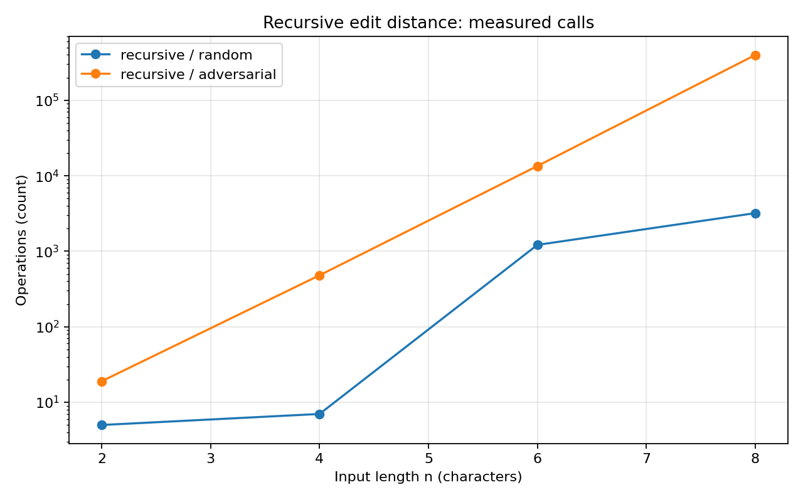
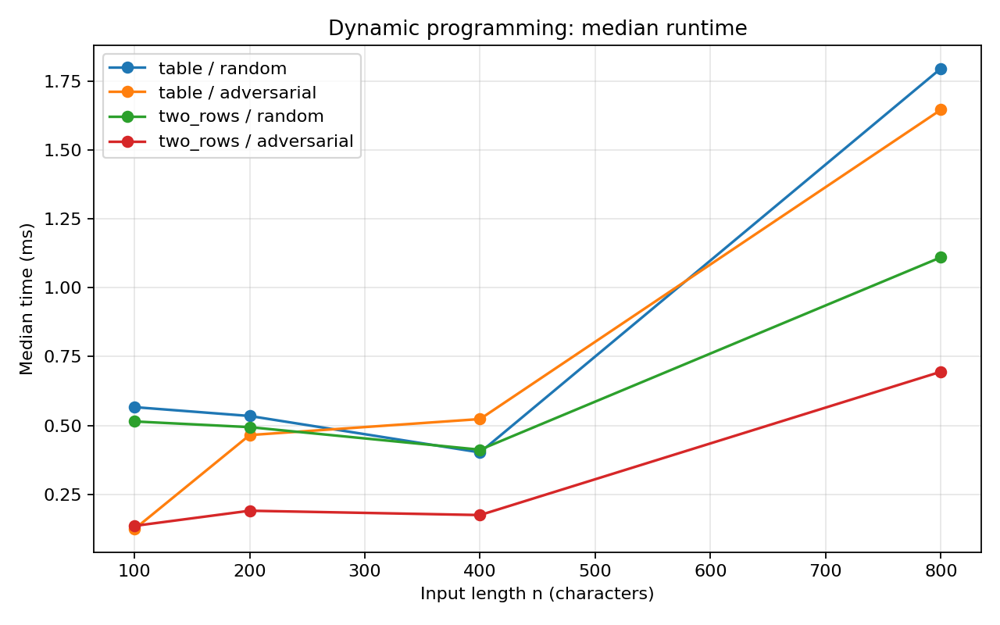
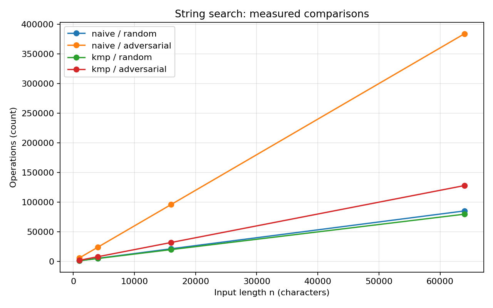
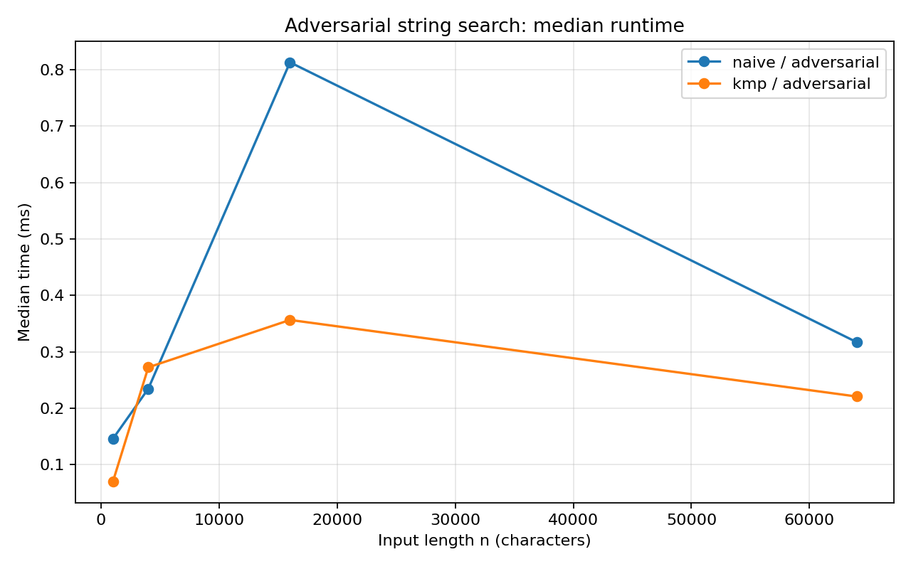

# Assignment 4 — Dynamic Programming and String Algorithms

**Student:** Satybaldy Amina  
**Group:** SE-2517

## 1. Experiment Design Card

### Research Questions

**Edit Distance:** How does the performance of Recursive, DP Table, and DP Two Rows change when the input size increases?

**String Search:** How do Naive Search and KMP compare on random and difficult inputs?

### Input Sizes

For Recursive Edit Distance, I selected:

`n = 2, 4, 6, 8`

I used small sizes because recursion without memoization becomes very slow when the input size increases.

For DP Table and DP Two Rows:

`n = 100, 200, 400, 800`

These sizes help demonstrate quadratic growth.

For String Search:

`n = 1000, 4000, 16000, 64000`

These sizes allow us to compare the algorithms on longer texts.

### Input Types

I used two input types for each algorithm family.

**1. Random Input**

Strings are generated using a fixed random seed.

This input type represents general cases where characters are randomly distributed.

**2. Adversarial Input**

For Edit Distance, I used strings containing different repeated characters, such as `aaaa` and `bbbb`.

This helps demonstrate repeated recursive calculations.

For String Search, I used a long text containing repeated `a` characters and the pattern `aaaaab`.

This is difficult for Naive Search because it repeatedly compares matching characters before finding a mismatch.

### Metrics

I measured:

- Execution time in milliseconds
- Number of recursive calls
- Number of DP cell updates
- Number of character comparisons

Execution time was measured using `System.nanoTime()`.

Each configuration was executed five times. I used the median time for the graphs.

The counters were increased inside the algorithms.

### Predictions

I expected Recursive Edit Distance to become very slow because it repeats calculations.

I expected DP Table and DP Two Rows to have similar time complexity, but Two Rows to use less memory.

For String Search, I expected Naive Search to perform more comparisons on repeated-character inputs.

I expected KMP to perform better because it uses the LPS array.

### Planned Plots

I planned four graphs:

1. Recursive Edit Distance operation counts
2. DP Table and DP Two Rows execution time
3. Naive and KMP character comparisons
4. Naive and KMP execution time on adversarial inputs

The first graph uses a logarithmic vertical axis to show the growth of recursive calls.

## 2. Implementation

### Edit Distance

I implemented three versions of the Edit Distance algorithm.

The Recursive version solves the problem using smaller subproblems without storing previous results.

The DP Table version stores results in a two-dimensional table.

The DP Two Rows version stores only two rows and reduces memory usage.

All three algorithms calculate the same minimum number of edit operations.

### String Search

I implemented Naive Search and KMP.

Naive Search checks the pattern at every possible position.

KMP first creates the LPS array and uses it to skip unnecessary comparisons.

Both algorithms return all matching positions, including overlapping matches.

## 3. Experimental Results and Graphs

The experiments were executed using Java.

A fixed seed was used to generate the random inputs.

The program saved 200 measurement records in `results/results.csv`.

### Plot 1 — Recursive Edit Distance

**Observation:** The number of recursive calls increases rapidly as the input size grows, especially when many characters are different.

This happens because the recursive algorithm calculates the same subproblems multiple times.

### Plot 2 — DP Table vs DP Two Rows

**Observation:** Both DP implementations show increasing running time as the input size grows, while the Two Rows version uses less memory.

Both algorithms process the same number of DP cells.

Their time complexity is O(n × m), but their memory requirements are different.

### Plot 3 — Naive vs KMP Comparisons

**Observation:** Naive Search performs many more character comparisons on repeated-character inputs, while KMP avoids repeated work.

KMP uses the LPS array to reuse information about previously matched characters.

### Plot 4 — Naive vs KMP Running Time

**Observation:** The measured running times can fluctuate, but the operation counters show why KMP is more efficient on difficult inputs.

Short execution times can be affected by JVM optimization and system activity.

For this reason, I used both time measurements and operation counters.

## 4. Prediction vs Results

### Edit Distance

I expected the Recursive algorithm to become much slower as the input size increased.

The experiment showed rapid growth in the number of recursive calls.

The DP Table and DP Two Rows versions completed larger inputs more efficiently.

Both DP versions use O(n × m) time, but Two Rows requires less memory.

### String Search

I expected KMP to be more efficient than Naive Search on difficult inputs.

The operation counts supported this prediction.

Naive Search repeated many character comparisons when the text contained repeated characters.

KMP reduced this repeated work using the LPS array.

The measured execution times were not always smooth, but the comparison counts showed the difference between the algorithms.

## 5. Short Answers

### Question 1. Which input made your string search slowest, and why?

The adversarial input was the most difficult for Naive Search. It contained many repeated `a` characters, while the pattern was `aaaaab`. Naive Search compared several matching characters before reaching the final mismatch. This repeated process increased the number of comparisons.

### Question 2. How large an n could the recursive Edit Distance handle, and what stopped it?

In my experiment, I tested Recursive Edit Distance up to n = 8. I selected this limit because recursion without memoization repeats many calculations. The number of recursive calls grows very quickly for different strings. Larger inputs would require much more execution time, so I did not include them in this experiment.

### Question 3. What do you gain and what do you lose when you use two rows instead of the full table?

The Two Rows version uses much less memory than the full DP table. It stores only the previous and current rows instead of all calculated values. Both versions have O(n × m) time complexity. However, the Two Rows version does not keep the complete table, so reconstructing the full sequence of editing operations becomes more difficult.

### Question 4. If you had to choose one string search for your city platform, which one and why?

I would choose KMP for searching patterns in long texts. KMP has O(n + m) time complexity and avoids unnecessary comparisons. It performs especially well when the text contains repeated characters. Naive Search is easier to implement, but KMP is more reliable for large inputs.

## 6. Discussion of Execution Time

Execution time depends on the computer, JVM optimization, and other running processes. Some measured times may change between repeated runs, especially when the algorithms finish very quickly. I used five runs for each configuration and calculated the median to reduce the effect of unusual measurements. I also used operation counters because they help explain algorithm performance independently of computer speed.

## 7. Testing

I used JUnit 5 to verify the correctness of the algorithms.

The tests included reference values, empty strings, overlapping matches, and invalid patterns.

I also compared the algorithms using randomly generated inputs.

The JUnit test results were:

- Tests run: 5
- Failures: 0
- Errors: 0
- Skipped: 0

All five tests passed successfully.

## 8. Conclusion

In this assignment, I implemented and compared five algorithms.

The experiments demonstrated that Recursive Edit Distance repeats calculations and becomes expensive as the input size increases.

Dynamic Programming improves efficiency by storing previous results. The Two Rows implementation also reduces memory usage.

For String Search, KMP avoids unnecessary comparisons and performs better on difficult repeated-character inputs.

I learned that algorithm performance should be evaluated using both theoretical complexity and experimental measurements. Operation counters and graphs helped me understand the results more clearly.